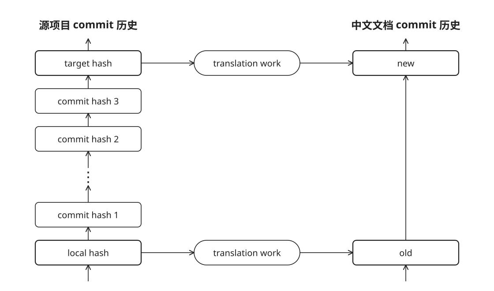

# 上游对齐规范

本指南旨在规范项目对齐源项目时的行为。作为源项目 Hindsight 的社区中文文档，本项目紧跟上游更新内容，且为项目本地化与兼容性做了大量改进。出于社区工作效率考虑，只翻译 docusaurus 的 current/Next 版本。

源项目存放于项目根目录下 `src-mono-repo` 中，默认对齐分支为 main。完成内容更新时，必须同步更新项目根目录下 [local-meta.json](../local-meta.json) 文件的 `local_hash` 为本次实际对齐的源提交7位哈希。

本规范常用术语（仅本文章使用，不是翻译术语表的一部分）：
- `local hash` 本地哈希，及当前中文文档对应的源项目 git 哈希
- `target hash` 目标哈希，本次增量更新对齐目标的 git 哈希
- `工程代码` docusaurus 文档工程相关代码、配置
- `Hindsight文档` 简称文档，一般指主文档、博客、集成文档和指南

## 工程代码对齐

本章节应对 docusaurus 文档工程代码相关更新。工程代码更新应当与文档更新分开处理，且工程代码更新完成以后才开始文档更新工作。

本项目工程代码做了大量本地化适配与兼容性改造，对齐工程代码时要保留这些变更。如果源项目页实现了这些变更，使用源项目的实现，并将本次合并明确写入对齐报告。

中文文档始终指向源文档的 current/Next 版本，且不保留 versioned 历史文档。

## 文档对齐

翻译页面时，页面关联的 SVG、动画 JSON、组件及示例文件中的新增可见内容随页面更新；共享资源只翻译一次。

对 `src/pages/changelog` 中新增的更新日志文件进行精简。只保留 `---` 声明的头部和 `#` 大标题以及 PageHero 部分（此部分要翻译），删除剩余部分并添加指向源项目的对应资源的链接（例如 `更新日志参考[官方原文](...)`）。

### 文档的增量对齐

使用 `git diff` 找出增量更新部分，并处理版本更新导致的文件路径变化。

- 新增页面翻译全文。
- 已有页面翻译 diff 中新增、修改的内容，并结合上下文调整受影响的译文。
- diff 不仅包括正文，也包括 URL、frontmatter、代码示例、导入路径、图表、组件数据和媒体引用。

## URL 与资源适配

- 同步源文变更后的链接目标、路径、查询参数和锚点。站内已有中文对应页时使用本站对应地址；外部链接保留其用途，不把全部链接统一改成中文站地址。
- GitHub 项目宣传入口指向源仓库主页；具体源码链接保留源文要求的分支或版本、文件路径和锚点。
- 本站 base URL 不同于源项目。新增 MDX 原生图片、视频和 source 引用复用 `StaticImage`、`StaticVideo`、`StaticSource`；组件内复用现有 base URL 处理，不硬编码部署前缀或重复补前缀。视频 `poster`、SVG 内嵌图片和动态图标路径同样适用。
- 新内容复用本站已有布局和中文动画支持。合入上游组件差异时保留本站适配，不恢复已移除的顶部额度横幅、导航注册入口、首页额度文案及博客侧栏 Cloud 推广卡片；正文中的 Cloud 说明和链接按源文更新。
- 技术文档会引用源项目 github 文件，这部分 URL 不变。

## 图片压缩

压缩二进制图片为 q=90 WebP 格式以节省空间。

待压缩对象满足如下三个条件：
1. 原图大于 25 KiB
2. 压缩后体积比原图减少超过 50%
3. 无损压缩图片或 ImageMagick 推断质量高于 90 的有损压缩图片

图片压缩任务仅针对 `git diff` 新增/变化的图片。压缩后要同步更新文档中的图片链接。

## README 更新

中文文档项目的 README 参考了源项目的部分内容（`Hindsight 社区中文文档` 前面的内容），发现源项目 README 变化时，向用户申请 README 修改许可，然后同步 README修改。

修改 README 可能涉及 URL 变化，仅将指向英文文档的部分改为中文文档链接，其余保持不变。
